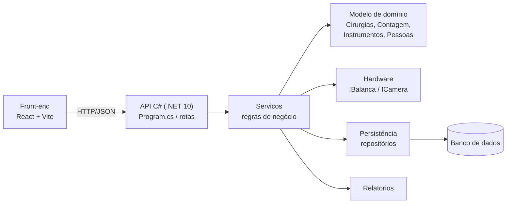
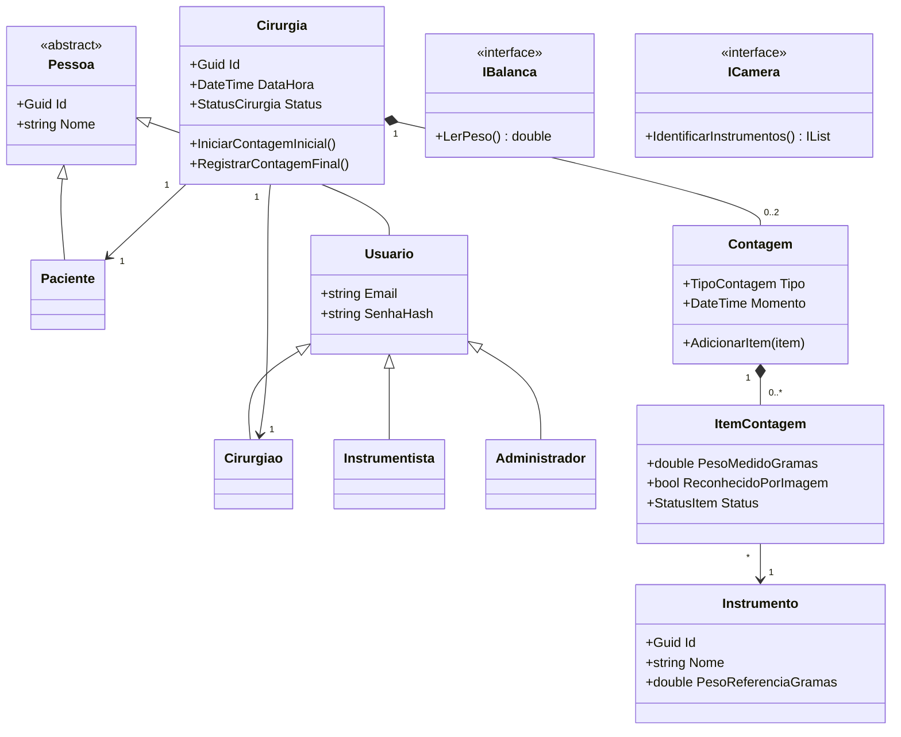

# scanOPS — Arquitetura

> Documento de referência para desenvolvimento (inclusive com IA). Leia antes de gerar código.
> Complementos: [`ROADMAP.md`](ROADMAP.md) (ordem de entrega) e [`ADR.md`](ADR.md) (decisões e motivos).

**Legenda:** ✅ definido no repositório/README · 🟡 proposto (ainda precisa ser confirmado pela equipe)

---

## 1. Visão geral

**scanOPS** é um sistema de controle de instrumentos cirúrgicos que evita que peças sejam esquecidas dentro do paciente.
A conferência usa **duas métricas ao mesmo tempo**:

1. **Peso** — medido por uma balança.
2. **Imagem** — reconhecimento de cada peça por câmera.

Projeto acadêmico (Ciência da Computação, UNIFESO), em grupo (marca Device Tech). Disciplina: POO.

### Fluxo do negócio ✅

1. Antes da cirurgia: **contagem inicial** (balança mede o peso, câmera identifica cada peça).
2. Ao final: **contagem final**.
3. O sistema **compara** as duas contagens e aponta instrumentos faltantes.
4. Se o peso medido não bate com o peso de referência do instrumento, o item é **sinalizado**.

---

## 2. Stack ✅

| Camada | Tecnologia |
|---|---|
| Back-end | C# / .NET 10 (API web) |
| Front-end | React + Vite (indicado pelo professor) |
| Comunicação | HTTP/JSON |
| Hardware | Balança e câmera, acessadas **somente** pelo back-end |
| Banco de dados | 🟡 a definir (ver ADR-007) |

---

## 3. Diagrama de componentes



**Regra de dependência:** as setas só apontam para a direita/baixo. O domínio não conhece serviços, API, banco nem hardware concreto.

---

## 4. Estrutura de pastas ✅

```
scanOPS/
├── banco de dados/   # persistência (README; ainda não aparece na raiz do GitHub)
├── Cirurgias/        # cirurgia e seu status
├── Contagem/         # contagem e itens contados
├── Hardware/         # balança e câmera
├── Instrumentos/     # cadastro de instrumentos
├── Pessoas/          # paciente, cirurgião e demais usuários
├── Relatorios/       # relatórios gerados
├── Servicos/         # regras de negócio
├── frontend/         # aplicação React (Vite)
├── Program.cs
└── scanOPS.csproj
```

> ⚠️ No GitHub as pastas são `Relatorios` e `Servicos` (maiúsculas), mas o README mostra minúsculas. **Padronizar** para evitar falha em Linux (sistema de arquivos diferencia maiúsculas).
> Namespaces: `ScanOPS.*` (ex.: `ScanOPS.Cirurgias`, `ScanOPS.Contagem`).

---

## 5. Modelo de domínio

Classes vindas dos diagramas UML do projeto. Atributos e métodos são 🟡 **propostas** — ajustar ao diagrama oficial.



**Enums** 🟡: `StatusCirurgia` (Agendada, EmAndamento, Concluida, ComPendencia), `TipoContagem` (Inicial, Final), `StatusItem` (Ok, Faltando, PesoDivergente), `PerfilUsuario`.

> Observação: o segundo diagrama usa os nomes `Procedimento`/`ItemProcedimento`. No código, usar os nomes do repositório: **`Cirurgia`** e **`ItemContagem`**. Documentar o equivalente para a banca.

### Regras de negócio

| # | Regra | Estado |
|---|---|---|
| RN1 | Uma cirurgia tem uma contagem inicial e uma final. | ✅ |
| RN2 | Item **faltante** = instrumento na contagem inicial que não aparece na final. | ✅ |
| RN3 | Item com **peso divergente** = peso medido ≠ peso de referência do instrumento. | ✅ |
| RN4 | Divergência de peso usa uma **tolerância** configurável (em gramas). | 🟡 valor a definir |
| RN5 | Cirurgia só é encerrada como "Concluída" se não houver pendências. | 🟡 |
| RN6 | A contagem final só é permitida depois de existir a inicial. | 🟡 |
| RN7 | Somente usuários autenticados operam o sistema; perfis limitam as ações. | 🟡 |

---

## 6. Hardware

- Acesso **exclusivo** pelo back-end (o front nunca fala com balança/câmera).
- `IBalanca` e `ICamera` em `Hardware/`; os serviços dependem **apenas das interfaces**.
- Implementações: reais (integração) e **simuladas** (`BalancaSimulada`, `CameraSimulada`) para desenvolver e testar sem equipamento (ADR-006).
- Implementação concreta escolhida por configuração/injeção de dependência em `Program.cs`.

---

## 7. Serviços (`Servicos/`)

| Serviço | Responsabilidade |
|---|---|
| `CirurgiaService` | Criar/abrir/encerrar cirurgia e controlar o status. |
| `ContagemService` | Executar contagem (ler balança + câmera) e **comparar inicial × final**. |
| `ConferenciaPesoService` | Validar peso medido contra o peso de referência (RN3/RN4). |
| `InstrumentoService` | Cadastro e consulta de instrumentos. |
| `AutenticacaoService` 🟡 | Login e perfis. |
| `RelatorioService` | Montar o relatório final da cirurgia. |

---

## 8. API (rotas) 🟡

Proposta inicial — confirmar quando a API for implementada.

| Método | Rota | Descrição |
|---|---|---|
| POST | `/api/auth/login` | Autenticar usuário |
| GET/POST | `/api/instrumentos` | Listar / cadastrar instrumentos |
| GET/POST | `/api/pacientes` | Listar / cadastrar pacientes |
| POST | `/api/cirurgias` | Nova cirurgia |
| GET | `/api/cirurgias/{id}` | Detalhe e status |
| POST | `/api/cirurgias/{id}/contagem-inicial` | Executar contagem inicial |
| POST | `/api/cirurgias/{id}/contagem-final` | Executar contagem final e comparar |
| GET | `/api/cirurgias/{id}/relatorio` | Relatório final |

Padrões: JSON, DTOs de entrada/saída (não expor entidades de domínio), códigos HTTP corretos, CORS liberado para `http://localhost:5173` em desenvolvimento.

---

## 9. Front-end ✅ (telas) / 🟡 (organização)

Mapa de 9 telas: **Login · Visão Geral · Paciente · Novo Procedimento · Instrumentos · Contagem Inicial · Procedimento em Andamento · Contagem Final · Relatório Final.**

- Login segue o mockup pronto (split-screen: foto de centro cirúrgico + formulário "Acesso ao Sistema", logo Device Tech).
- Camada `api/` única no front concentra as chamadas HTTP.
- Dev: `http://localhost:5173` → API em `http://localhost:5000`.

---

## 10. Como executar ✅

```bash
# Back-end (terminal 1)
dotnet run --urls http://localhost:5000

# Front-end (terminal 2)
cd frontend
npm install
npm run dev     # http://localhost:5173
```

---

## 11. Convenções para desenvolvimento com IA

Cole este bloco no início de qualquer pedido de código:

```
Contexto: projeto scanOPS (C# .NET 10 + React/Vite). Leia ARCHITECTURE.md, ADR.md e ROADMAP.md.
Regras:
- Domínio não depende de serviços, API, banco ou hardware concreto.
- Hardware só via IBalanca/ICamera (use as simuladas em dev).
- Regras de negócio ficam em Servicos/, nunca em controllers/rotas.
- Namespaces ScanOPS.<Pasta>. Nomes de classes em PT-BR, como no repositório.
- API devolve DTOs, não entidades.
- Implemente SOMENTE a tarefa pedida; não altere outras pastas.
- Inclua testes para regras de negócio (RN1–RN7).
- Se algo estiver marcado 🟡, pergunte antes de decidir.
```

---

## 12. Segurança e pontos de atenção

- **Credenciais:** o README traz um e-mail e senha de demonstração. Nunca versionar credenciais reais; senhas sempre com hash.
- Corrigir o comando de clone do README (`SEU-USUARIO/SEU-REPO`).
- Padronizar maiúsculas/minúsculas das pastas (seção 4).
- Dados de paciente são sensíveis: minimizar o que é armazenado e exibido.

---

## 13. Glossário

| Termo | Significado |
|---|---|
| Contagem inicial | Inventário dos instrumentos antes da cirurgia. |
| Contagem final | Inventário ao término da cirurgia. |
| Peso de referência | Peso esperado de um instrumento (cadastrado). |
| Dupla métrica | Verificação simultânea por peso e por imagem. |
| Item divergente | Item cujo peso ou reconhecimento não confere. |
