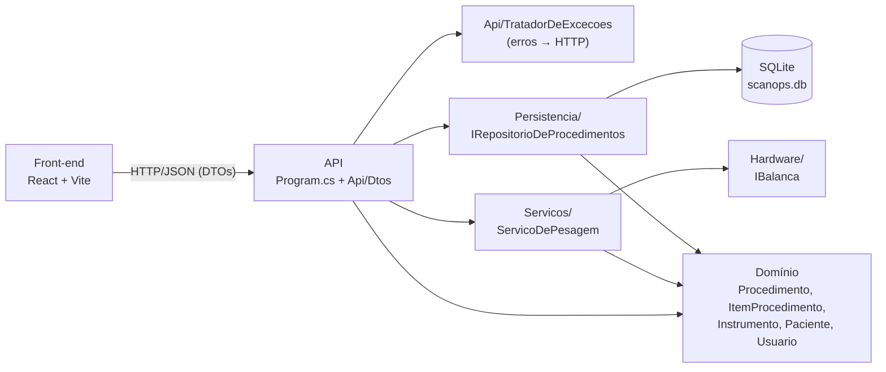

# scanOPS — Arquitetura

> Descreve o sistema **como ele está implementado**. Detalhes de regras, modelo e testes estão em
> [`av2/`](av2/README.md). Decisões e motivos: [`ADR.md`](ADR.md). Andamento: [`ROADMAP.md`](ROADMAP.md).
>
> Revisado em 15/11/2026. Versões anteriores deste documento descreviam um planejamento
> (classes `Cirurgia`/`ItemContagem`, sete regras "propostas", serviços e rotas que não foram
> criados). Esse conteúdo foi substituído pelo que existe no código.

---

## 1. Visão geral

**scanOPS** controla instrumentos cirúrgicos para evitar que peças sejam esquecidas no paciente.
Cada procedimento registra quantas unidades de cada instrumento **entraram** em campo (contagem
inicial) e quantas **voltaram** (contagem final), confere o **peso** medido com o peso de
referência e só pode ser encerrado sem divergência ou com justificativa.

Projeto acadêmico (UNIFESO), disciplina Design e Programação Orientados a Objetos.

**Dupla métrica (peso + imagem):** o peso é conferido no back-end (balança atrás de `IBalanca`).
A identificação por câmera existe só como interface e simulação (`ICamera`, `CameraSimulada`);
hoje o cliente informa `identificadoPorCamera` na contagem final e nenhuma rota usa a câmera.

## 2. Stack

| Camada | Tecnologia |
|---|---|
| Back-end | C# / .NET 10, ASP.NET Core minimal API (`Program.cs`) |
| Banco de dados | SQLite local via Entity Framework Core 10 (`scanops.db`, criado automaticamente) |
| Testes | xUnit + `Microsoft.AspNetCore.Mvc.Testing` (API em memória com banco temporário) |
| Front-end | React + Vite (`frontend/`) |
| Comunicação | HTTP/JSON com DTOs |
| Hardware | Balança e câmera simuladas, acessadas só pelo back-end |

## 3. Componentes



- **Regras de negócio ficam no domínio** (métodos de `Procedimento` e `ItemProcedimento`), não nas
  rotas nem em serviços. Ver ADR-011.
- O domínio não conhece EF Core, HTTP nem hardware concreto. O mapeamento para o banco fica em
  `Persistencia/ScanOpsDbContext.cs`.
- Cada rota segue o padrão **carregar → chamar método de domínio → gravar**. Se o domínio lança
  exceção, nada é gravado e o `TratadorDeExcecoes` responde.

## 4. Estrutura de pastas

```
scanOPS/
├── Api/                 # TratadorDeExcecoes e Dtos/ (contrato com o front)
├── Cirurgias/           # Procedimento, StatusProcedimento
├── Contagem/            # ItemProcedimento, StatusItem (namespace ScanOPS.Contagens)
├── Excecoes/            # RegraDeNegocioException
├── Hardware/            # IBalanca, BalancaSimulada, BalancaComRuido, ConfiguracaoDeHardware,
│                        # FalhaDeHardwareException, ICamera, CameraSimulada
├── Instrumentos/        # Instrumento, TipoInstrumento
├── Persistencia/        # ScanOpsDbContext, repositório, InicializadorDoBanco
├── Pessoas/             # Paciente, Usuario, TipoUsuario
├── Relatorios/          # Relatorio, StatusAssinatura
├── Servicos/            # ServicoDePesagem, Demonstracao
├── tests/ScanOPS.Tests/ # testes automatizados
├── docs/                # este documento, ADR, roadmap e av2/
├── frontend/            # React + Vite
├── Program.cs           # configuração e rotas
├── appsettings.json     # banco e tipo de balança
└── scanOPS.sln
```

Namespaces: `ScanOPS.<Pasta>`, exceto `Contagem/` → `ScanOPS.Contagens` e `Api/Dtos/` → `ScanOPS.Api.Dtos`.

## 5. Modelo de domínio

Resumo (diagrama completo, com atributos, métodos, multiplicidades e invariante, em
[`av2/modelo-classes.md`](av2/modelo-classes.md)):

- `Procedimento` — objeto central e raiz do agregado; estados `Planejado → EmAndamento → Finalizado`
  ou `Planejado → Cancelado`; é o único que altera o próprio status e os itens.
- `ItemProcedimento` — **composição** dentro do procedimento; quantidades prevista, inicial e final,
  peso medido, status `Pendente/Conferido/Divergente`.
- `Instrumento` — cadastro com `PesoReferencia`; associado aos itens.
- `Paciente`, `Usuario` (senha com hash SHA-256), `Relatorio` (assinaturas por perfil; PDF não implementado).
- Não há hierarquia `Pessoa`/subclasses de usuário: o perfil é o enum `TipoUsuario`.

### Regras de negócio

| Id | Regra | Onde |
|---|---|---|
| RN1 | Só inicia procedimento `Planejado` | `Procedimento.Iniciar` |
| RN2 | Só finaliza procedimento `EmAndamento` | `Procedimento.Finalizar` |
| RN3 | Divergência exige justificativa para finalizar | `Procedimento.Finalizar` |
| RN4 | Peso medido = referência × quantidade inicial, tolerância ±2 g | `ItemProcedimento.ConferePeso` |
| RN5 | Contagem só `EmAndamento`; entrada > 0, saída ≥ 0, peso ≥ 0 | `Procedimento.RegistrarEntrada/Saida/Peso` |

Critérios de aceitação e testes de cada regra: [`av2/especificacao.md`](av2/especificacao.md) e
[`av2/rastreabilidade.md`](av2/rastreabilidade.md).

## 6. Hardware

- Acesso exclusivo pelo back-end.
- `IBalanca` tem duas implementações: `BalancaSimulada` (peso exato) e `BalancaComRuido` (ruído e
  deriva). A escolhida vem de `appsettings.json` → `Balanca:Tipo` e é registrada por injeção de
  dependência em `Hardware/ConfiguracaoDeHardware.cs`.
- `ServicoDePesagem` usa a balança injetada; se ela não responder, lança `FalhaDeHardwareException` (HTTP 503).
- `ICamera`/`CameraSimulada` existem mas não são usadas pela API.
- Não há implementação de hardware real.

## 7. API

Todas as rotas recebem e devolvem DTOs (`Api/Dtos/`); erros saem como `{ "erro": "..." }`.

| Método | Rota | Descrição |
|---|---|---|
| GET | `/api/teste` | Verifica se a API está no ar |
| POST | `/api/login` | Autentica por e-mail e senha (401 se inválido) |
| GET/POST | `/api/instrumentos` | Lista / cadastra |
| GET/PUT/DELETE | `/api/instrumentos/{id}` | Detalhe / edita / exclui (400 se usado em procedimento) |
| GET/POST | `/api/pacientes` | Lista / cadastra |
| GET/PUT/DELETE | `/api/pacientes/{id}` | Detalhe / edita / exclui (400 se tem procedimento) |
| POST | `/api/procedimentos` | Planeja um procedimento (`Planejado`) |
| GET | `/api/procedimentos/{id}` | Detalhe |
| POST | `/api/procedimentos/{id}/iniciar` | Inicia (RN1) |
| POST | `/api/procedimentos/{id}/cancelar` | Cancela com motivo |
| GET | `/api/procedimento-atual` | Procedimento de início mais recente, com itens |
| POST | `/api/procedimento-atual/itens/{itemId}/entrada` | Contagem inicial (RN5) |
| POST | `/api/procedimento-atual/itens/{itemId}/saida` | Contagem final + peso + câmera (RN5) |
| POST | `/api/procedimento-atual/itens/{itemId}/pesar` | Lê a balança configurada e grava o peso |
| POST | `/api/procedimento-atual/finalizar` | Finaliza (RN2, RN3) |

Códigos de erro: regra violada → 400; recurso inexistente → 404; JSON inválido → 400; balança
indisponível → 503; erro inesperado → 500 (sem detalhes internos). Ver
[`av2/tratamento-de-falhas.md`](av2/tratamento-de-falhas.md).

As rotas **não** exigem usuário autenticado (ver ADR-008).

## 8. Front-end

Telas: Login, Visão Geral, Paciente, Novo Procedimento, Instrumentos, Contagem Inicial,
Procedimento em Andamento, Contagem Final, Relatório Final. As chamadas HTTP ficam em cada página
(não há camada `api/` única). A tela Novo Procedimento ainda não usa as rotas de planejar/iniciar.
Desenvolvimento: front em `http://localhost:5173`, API em `http://localhost:5000` (CORS liberado para 5173/5174).

## 9. Como executar

```bash
dotnet build
dotnet test
dotnet run --urls http://localhost:5000   # cria scanops.db na primeira execução

cd frontend
npm install
npm run dev                                # http://localhost:5173
```

## 10. Convenções para desenvolvimento (inclusive com IA)

```
Contexto: projeto scanOPS (C# .NET 10 + EF Core/SQLite + React/Vite). Leia docs/ARCHITECTURE.md,
docs/ADR.md e docs/av2/especificacao.md.
Regras:
- Regras de negócio ficam nos métodos do domínio (Procedimento, ItemProcedimento), nunca nas rotas.
- Só o Procedimento altera seus itens e seu status; não exponha setters públicos de contagem.
- Violação de regra: lance RegraDeNegocioException. Falha de equipamento: FalhaDeHardwareException.
  As rotas não usam try/catch; o TratadorDeExcecoes responde.
- Hardware só via IBalanca/ICamera.
- A API recebe e devolve DTOs de Api/Dtos, nunca entidades.
- Namespaces ScanOPS.<Pasta>; nomes de classes em português.
- Implemente SOMENTE a tarefa pedida e inclua testes (sucesso e violação da regra).
- Rode dotnet build e dotnet test antes de considerar pronto.
```

## 11. Segurança e pontos de atenção

- Senhas guardadas com hash SHA-256 (sem *salt*). A conta `medico@scanops.com / 123456` é só de demonstração.
- Rotas sem controle de acesso por usuário/perfil.
- Dados de paciente são sensíveis: o `scanops.db` fica fora do Git (`.gitignore`).
- O banco usa `EnsureCreated` (sem migrações): após mudanças no modelo, apague o `scanops.db`.

## 12. Glossário

| Termo | Significado |
|---|---|
| Contagem inicial | Unidades de cada instrumento que entraram em campo (`QuantidadeInicial`). |
| Contagem final | Unidades que voltaram (`QuantidadeFinal`). |
| Peso de referência | Peso cadastrado de uma unidade do instrumento. |
| Divergência | Contagem inicial ≠ final, ou peso fora da tolerância. |
| Procedimento atual | O procedimento com início mais recente; é o usado pelas telas de contagem. |
