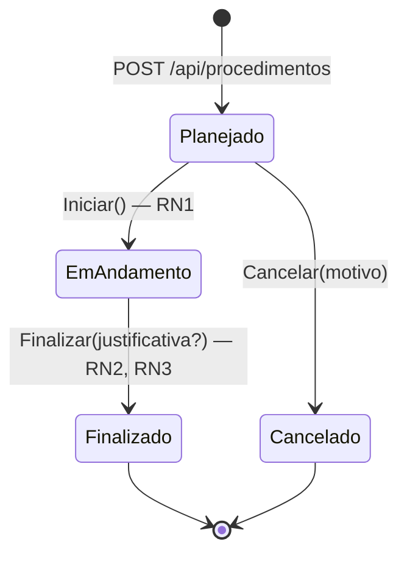

# Especificação de requisitos — scanOPS

Esta especificação descreve o que **está implementado** no back-end (C# / .NET 10). Cada fluxo
e cada regra aponta para o código e para os testes que a verificam
(ver também [rastreabilidade.md](rastreabilidade.md)).

## 1. Objetivo

Evitar que instrumentos cirúrgicos sejam esquecidos no paciente. Cada procedimento cirúrgico
registra quantos instrumentos de cada tipo **entraram** em campo (contagem inicial) e quantos
**voltaram** (contagem final), confere o **peso** medido em balança e só pode ser encerrado sem
divergência ou com uma justificativa registrada.

## 2. Conceitos

| Termo | Classe no código | Significado |
|---|---|---|
| Procedimento | `Cirurgias/Procedimento.cs` | Uma cirurgia, com paciente, equipe e lista de itens contados. É o objeto central. |
| Item do procedimento | `Contagem/ItemProcedimento.cs` | Um tipo de instrumento dentro de um procedimento, com quantidade prevista, inicial, final e peso medido. |
| Instrumento | `Instrumentos/Instrumento.cs` | Cadastro do instrumento (nome, código, tipo, peso de referência). |
| Paciente / Usuário | `Pessoas/Paciente.cs`, `Pessoas/Usuario.cs` | Paciente operado; cirurgião e instrumentista. |
| Balança | `Hardware/IBalanca.cs` | Contrato do equipamento de pesagem (duas implementações simuladas). |
| Divergência | `ItemProcedimento.PossuiDivergencia()` | Contagem inicial diferente da final **ou** peso fora da tolerância. |

## 3. Estados do Procedimento

| Estado | Contagem permitida? | Pode ir para |
|---|---|---|
| `Planejado` | Não | `EmAndamento`, `Cancelado` |
| `EmAndamento` | Sim | `Finalizado` |
| `Finalizado` | Não | — (estado final) |
| `Cancelado` | Não | — (estado final) |

Qualquer outra transição é recusada com `RegraDeNegocioException` e o objeto permanece como estava
(o `Id` nunca muda). Implementação: `Cirurgias/StatusProcedimento.cs` e métodos de `Procedimento`.

## 4. Regras de negócio

| Id | Regra | Onde é garantida |
|---|---|---|
| **RN1** | Um procedimento só pode ser **iniciado** se estiver `Planejado`. | `Procedimento.Iniciar()` |
| **RN2** | Um procedimento só pode ser **finalizado** se estiver `EmAndamento`. | `Procedimento.Finalizar()` |
| **RN3** | Se houver **divergência** em algum item, a finalização exige uma **justificativa** não vazia, que fica registrada em `Observacoes`. | `Procedimento.Finalizar()` |
| **RN4** | O **peso medido** de um item deve ser igual a `PesoReferencia × QuantidadeInicial`, com tolerância de **±2 g**; fora disso o item é divergente. | `ItemProcedimento.ConferePeso()` / `PossuiDivergencia()` |
| **RN5** | Contagens (entrada, saída, peso) só são aceitas com o procedimento `EmAndamento` e com valores válidos: entrada **> 0**; saída **≥ 0** (zero = nenhuma unidade voltou); peso **≥ 0**. | `Procedimento.RegistrarEntrada/RegistrarSaida/RegistrarPeso` |
| **RN6** | Instrumento **inativo** não pode ser adicionado a um procedimento novo. | `Procedimento.AdicionarInstrumento()` |

Regras complementares (também implementadas e testadas):

- Itens só podem ser adicionados enquanto o procedimento está `Planejado`, com quantidade prevista > 0.
- Cancelamento só a partir de `Planejado` e com motivo (depois de iniciado, os instrumentos já estão em campo e precisam ser contados).
- Instrumento ou paciente já usado em um procedimento não pode ser excluído (o instrumento pode ser inativado: `POST /api/instrumentos/{id}/inativar`, e reativado: `/reativar`).
- Sexo do paciente: `Masculino`, `Feminino` ou `Não informado`; tipo sanguíneo: `A+`, `A-`, `B+`, `B-`, `AB+`, `AB-`, `O+`, `O-` ou `Não informado`. Vazio vira `Não informado`; outro valor é recusado (HTTP 400).

Durante a operação, cada item da resposta da API traz o peso esperado e se o peso e a contagem conferem
(`pesoEsperado`, `pesoConfere`, `possuiDivergencia`), calculados pelo domínio, para a tela mostrar a
divergência antes da finalização. O `status` do item só muda para `Conferido`/`Divergente` ao finalizar.

## 5. Fluxos

As rotas abaixo existem em `Program.cs`. Todas seguem o mesmo padrão: carregar o procedimento pelo
repositório → chamar um método do domínio (que aplica as regras) → gravar. Se o domínio recusar,
nada é gravado e a API responde com o código definido em [tratamento-de-falhas.md](tratamento-de-falhas.md).

### F1 — Planejar, iniciar e fazer a contagem inicial

1. `POST /api/procedimentos` cria o procedimento `Planejado` com paciente, equipe e instrumentos previstos (só instrumentos ativos, RN6).
2. `POST /api/procedimentos/{id}/iniciar` inicia (RN1). A partir daí ele é o **procedimento atual**
   (`GET /api/procedimento-atual` devolve o de início mais recente).
3. `POST /api/procedimento-atual/itens/{itemId}/entrada` registra as unidades que entraram em campo (RN5).

### F2 — Contagem final e conferência de peso

1. `POST /api/procedimento-atual/itens/{itemId}/saida` registra as unidades que voltaram, o peso medido e se a câmera identificou o instrumento (RN5).
2. Opcionalmente, `POST /api/procedimento-atual/itens/{itemId}/pesar` lê a balança configurada (`IBalanca`) e grava o peso (RN5). Se a balança não responder, a API devolve 503.
3. `GET /api/procedimento-atual` mostra, por item, a diferença entre entrada e saída; a conferência de peso segue a RN4.

### F3 — Finalização (com ou sem justificativa)

1. `POST /api/procedimento-atual/finalizar` com `{ "justificativa": null }`:
   - sem divergência → `Finalizado` (RN2); cada item fica `Conferido`;
   - com divergência → recusado (RN3), nada muda.
2. Com divergência, o mesmo pedido com uma justificativa → `Finalizado`; os itens divergentes ficam `Divergente` e a justificativa é gravada.
3. Depois de finalizado, qualquer contagem é recusada (RN5) — o registro cirúrgico fica fechado.

Limitação conhecida: o relatório em PDF (`Relatorio.GerarPDF`) **não** está implementado; ver [auditoria-final.md](auditoria-final.md).

## 6. Critérios de aceitação

Cada critério corresponde a pelo menos um teste automatizado (nome entre parênteses; arquivos em `tests/ScanOPS.Tests/`).

### RN1 — iniciar só se Planejado
- **CA-RN1.1** Dado um procedimento `Planejado`, quando ele é iniciado, então fica `EmAndamento` e `DataHoraInicio` é preenchida. (`RN1_Sucesso_IniciarPlanejado_FicaEmAndamento`; pela API: `RN1_Iniciar_ProcedimentoPlanejado_FicaEmAndamentoGravadoEViraOProcedimentoAtual`)
- **CA-RN1.2** Dado um procedimento `EmAndamento`, quando se tenta iniciá-lo de novo, então a operação é recusada e a data de início não muda. (`RN1_Violacao_IniciarJaEmAndamento_LancaEMantemDataDeInicio`; pela API, com HTTP 400: `RN1_IniciarDuasVezes_Retorna400EMantemADataDeInicioGravada`)
- **CA-RN1.3** Dado um procedimento `Cancelado`, quando se tenta iniciá-lo, então a operação é recusada. (`RN1_Violacao_IniciarCancelado_Lanca`)

### RN2 — finalizar só se EmAndamento
- **CA-RN2.1** Dado um procedimento `EmAndamento` sem divergência, quando é finalizado, então fica `Finalizado`, com `DataHoraFim`, e os itens ficam `Conferido`. (`RN2_Sucesso_FinalizarEmAndamentoSemDivergencia_FicaFinalizado`)
- **CA-RN2.2** Dado um procedimento `Planejado`, quando se tenta finalizar, então é recusado e continua `Planejado`. (`RN2_Violacao_FinalizarPlanejado_LancaEMantemPlanejado`)
- **CA-RN2.3** Dado um procedimento já `Finalizado`, quando se tenta finalizar de novo, então é recusado e a data de fim não muda. (`RN2_Violacao_FinalizarDuasVezes_LancaEMantemDataDeFim`)

### RN3 — divergência exige justificativa
- **CA-RN3.1** Dado um item com entrada 2 e saída 1, quando se finaliza com justificativa, então o procedimento fica `Finalizado`, o item `Divergente` e a justificativa é registrada. (`RN3_Sucesso_DivergenciaComJustificativa_FinalizaERegistraJustificativa`; gravação no banco: `ContagemEFinalizacaoComJustificativa_SaoGravadasNoBanco`)
- **CA-RN3.2** Dado o mesmo cenário, quando se finaliza com justificativa nula, vazia ou só com espaços, então é recusado com mensagem que menciona "justificativa" e o procedimento continua `EmAndamento`. (`RN3_Violacao_DivergenciaSemJustificativa_Lanca`; pela API, HTTP 400: `F1_Api_FinalizarComDivergenciaSemJustificativa_Retorna400ComMensagemDaRegra`)
- **CA-RN3.3** Quando a finalização é recusada, nenhum item muda de status e nada é gravado. (`FinalizarRecusadoPorDivergencia_NaoAlteraNenhumEstado`, `FinalizacaoRecusada_NaoGravaNenhumaAlteracaoNoBanco`)

### RN4 — peso com tolerância de ±2 g
- **CA-RN4.1** Dado um item com 2 pinças de 50 g, quando o peso medido é 98 g, 100 g ou 102 g, então o peso confere e o procedimento finaliza sem justificativa. (`RN4_Sucesso_PesoDentroDaTolerancia_ItemSemDivergencia`)
- **CA-RN4.2** Dado o mesmo item, quando o peso medido é 102,01 g ou 50 g (contagem bate, peso não), então o item é divergente e a finalização exige justificativa. (`RN4_Violacao_PesoForaDaTolerancia_ItemDivergenteEFinalizarExigeJustificativa`)
- **CA-RN4.3** A leitura de qualquer balança configurada (exata ou com ruído) respeita a tolerância. (`MesmoServico_ComQualquerBalanca_GravaPesoQueRespeitaRN4`)

### RN5 — contagem só EmAndamento e com valores válidos
- **CA-RN5.1** Dado um procedimento `EmAndamento`, quando se registra entrada 2 e saída 2, então as quantidades são atualizadas e a diferença é 0. (`RN5_Sucesso_EntradaESaidaEmAndamento_AtualizamContagem`)
- **CA-RN5.2** Dado um procedimento `Finalizado`, quando se registra entrada, saída ou peso, então é recusado (HTTP 400) e a contagem gravada não muda. (`ProcedimentoFinalizado_RecusaTodaAlteracaoEPermaneceIntacto`, `RegistrarEntrada_DepoisDeFinalizado_RetornaBadRequestENaoAlteraContagem`, `ContagemAposFinalizar_ERecusadaEOBancoContinuaComOsValoresFinais`)
- **CA-RN5.3** Dado um procedimento `Planejado`, quando se registra entrada, então é recusado. (`RN5_Violacao_EntradaComProcedimentoPlanejado_Lanca`)
- **CA-RN5.4** Quando a entrada é 0 ou negativa, ou a saída/peso é negativo, então é recusado e nada muda; saída 0 é aceita. (`RegistrarEntrada_QuantidadeMenorOuIgualAZero_LancaExcecaoENaoAlteraContagem`, `RN5_Violacao_PesoNegativoNaSaida_LancaENaoAlteraNada`, `RegistrarSaida_QuantidadeZero_EhAceita`)

### RN6 — instrumento inativo não entra em procedimento novo
- **CA-RN6.1** Dado um instrumento ativo, quando é adicionado a um procedimento planejado, então vira um item do procedimento. (`RN6_Sucesso_InstrumentoAtivo_EhAdicionado`)
- **CA-RN6.2** Dado um instrumento inativo, quando se tenta adicioná-lo, então é recusado com mensagem que menciona "inativo" e a lista de itens não muda. (`RN6_Violacao_InstrumentoInativo_LancaENaoAlteraLista`)
- **CA-RN6.3** Dado um instrumento inativado e depois reativado, quando é adicionado, então é aceito. (`RN6_Sucesso_InstrumentoReativado_VoltaASerAceito`)
- **CA-RN6.4** Pela API: planejar com instrumento inativo responde 400 e nenhum procedimento é gravado; depois de reativar, o mesmo pedido responde 201. (`RN6_PlanejarComInstrumentoInativo_Retorna400ENadaEGravado_EReativadoFunciona`)

### Fluxos ponta a ponta
- **CA-F1** Dado o banco de demonstração, quando se planeja um procedimento com 3 pinças e 1 tesoura e ele é iniciado, então fica gravado `EmAndamento` e passa a ser o procedimento atual. (`Planejar_CriaProcedimentoPlanejadoComOsItensPrevistos`, `RN1_Iniciar_ProcedimentoPlanejado_FicaEmAndamentoGravadoEViraOProcedimentoAtual`)
- **CA-F2** Dado um procedimento em andamento, quando a balança configurada é lida pela rota `/pesar`, então o peso é gravado no item; se a balança falhar, a API responde 503 sem detalhes internos. (`Api_PesarComBalancaFuncionando_Retorna200EGravaPesoNoItem`, `F3_Api_ErroNaBalanca_Retorna503ComMensagemGenericaSemDetalhesInternos`)
- **CA-F3** Dado um item com falta de 1 unidade, quando se finaliza com justificativa, então o status, a justificativa, as quantidades e o peso ficam gravados no banco. (`ContagemEFinalizacaoComJustificativa_SaoGravadasNoBanco`)
