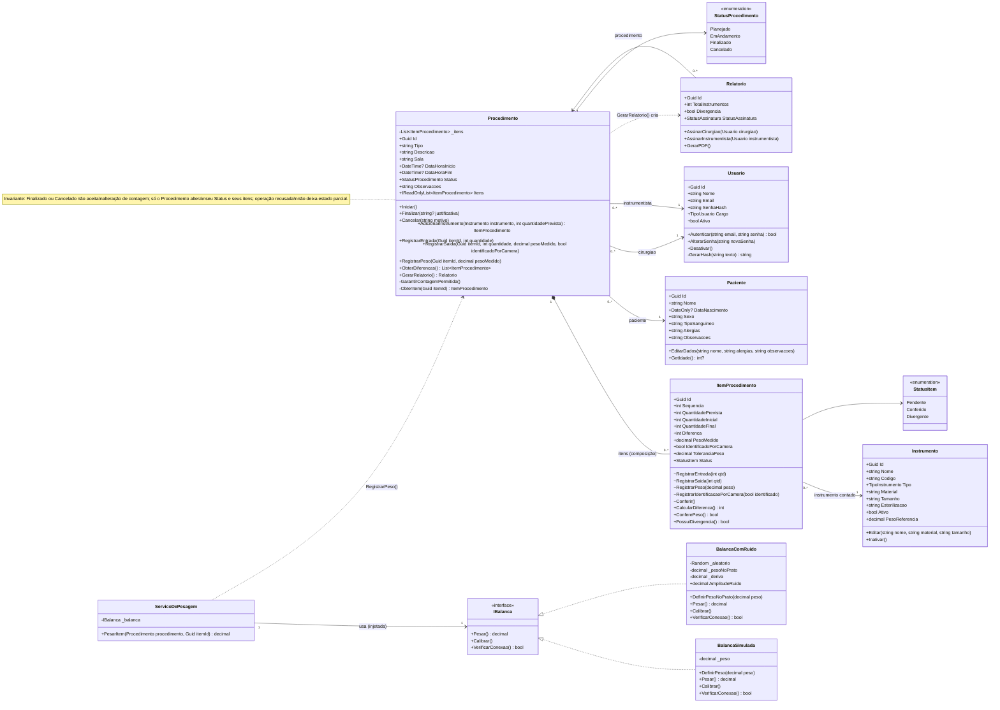

# Modelo de classes — scanOPS

Modelo **derivado do código** (não do planejamento inicial). Os nomes de classes, atributos e
métodos são exatamente os do C#. Visibilidade: `+` público, `-` privado, `~` internal
(visível só dentro do projeto da API). Membros de infraestrutura (construtor usado pelo EF Core,
constantes) foram omitidos.

## 1. Correspondência modelo ↔ código (B01, B02, B03)

Classes de domínio do modelo e onde estão implementadas. Atributos e métodos do diagrama são os
membros reais destes arquivos, conferidos contra o código desta mesma versão do repositório.

| Classe no modelo | Arquivo C# | Responsabilidade |
|---|---|---|
| `Procedimento` | `Cirurgias/Procedimento.cs` | Ciclo de vida da cirurgia, regras RN1, RN2, RN3, RN5; dono dos itens |
| `ItemProcedimento` | `Contagem/ItemProcedimento.cs` | Contagem de um instrumento; conferência de peso (RN4) |
| `Instrumento` | `Instrumentos/Instrumento.cs` | Cadastro e peso de referência |
| `Paciente` | `Pessoas/Paciente.cs` | Dados do paciente; cálculo da idade |
| `Usuario` | `Pessoas/Usuario.cs` | Autenticação com senha em hash (SHA-256) |
| `Relatorio` | `Relatorios/Relatorio.cs` | Resumo do procedimento e assinaturas por perfil |
| `IBalanca` / `BalancaSimulada` / `BalancaComRuido` | `Hardware/` | Contrato e implementações da pesagem |
| `ServicoDePesagem` | `Servicos/ServicoDePesagem.cs` | Liga a balança ao procedimento |

O modelo **não é cópia** do banco: `ProcedimentoId`, `InstrumentoId`, `PacienteId`, `CirurgiaoId` e
`InstrumentistaId` são colunas de chave estrangeira criadas pelo EF Core (`Persistencia/ScanOpsDbContext.cs`)
e não aparecem nas classes. Da mesma forma, `Diferenca` é calculada e não é gravada.

## 2. Associações e multiplicidade (B04)

| Associação | Multiplicidade | Implementação | Cenário que a comprova |
|---|---|---|---|
| Procedimento → ItemProcedimento | 1 para 0..* | `List<ItemProcedimento> _itens` exposta como `IReadOnlyList` | `Planejar_CriaProcedimentoPlanejadoComOsItensPrevistos` grava 2 itens num procedimento |
| ItemProcedimento → Instrumento | 0..* para 1 | propriedade `Instrumento` obrigatória (passada no construtor) | o mesmo instrumento (Pinça Kelly) aparece no procedimento de demonstração e no planejado pelo teste |
| Procedimento → Paciente | 0..* para 1 | propriedade `Paciente` | `POST /api/procedimentos` com `pacienteId` inexistente → 404 (`Planejar_PacienteInexistente_Retorna404`) |
| Procedimento → Usuario | 0..* para 1 (duas vezes: cirurgião e instrumentista) | `Cirurgiao` e `Instrumentista` | no seed, o mesmo usuário ocupa os dois papéis |

A multiplicidade não expressa todas as regras: "um item só pode ser adicionado enquanto o
procedimento está Planejado" não cabe no diagrama e é garantido por `AdicionarInstrumento`
(teste `AdicionarInstrumento_DepoisDeIniciado_LancaENaoAlteraLista`).

## 3. Composição: Procedimento ◆— ItemProcedimento (B05)

`ItemProcedimento` **não existe fora** de um `Procedimento`. Evidências no código:

1. O construtor de `ItemProcedimento` é `internal`; o único lugar que cria itens é `Procedimento.AdicionarInstrumento` (`Cirurgias/Procedimento.cs`).
2. A lista é privada (`_itens`) e exposta só como `IReadOnlyList` — ninguém de fora adiciona ou remove itens.
3. No banco, apagar o procedimento apaga os itens: `HasMany(x => x.Itens)...OnDelete(DeleteBehavior.Cascade)` em `Persistencia/ScanOpsDbContext.cs`.
4. Já `Instrumento` é **associação**, não composição: `OnDelete(DeleteBehavior.Restrict)`; o instrumento tem vida própria e não pode ser apagado se foi usado (teste `ExcluirInstrumentoUsadoEmProcedimento_ERecusadoEInstrumentoPermanece`).

Testes de auditoria do encapsulamento que sustenta a composição: `ItemProcedimento_MetodosDeAlteracaoEConstrutorNaoSaoPublicos`, `Procedimento_StatusEItensNaoPodemSerAlteradosDeFora`.

## 4. Contrato polimórfico IBalanca (B06)

| | `BalancaSimulada` | `BalancaComRuido` |
|---|---|---|
| `Pesar()` | devolve sempre o peso definido, exato | peso no prato + deriva + ruído aleatório (±`AmplitudeRuido`), nunca negativo |
| `Calibrar()` | zera o peso | zera a deriva acumulada |
| `VerificarConexao()` | `true` | `true` |

- Escolha por configuração: `appsettings.json` → `Balanca:Tipo` (`Simulada` ou `ComRuido`), registrada em `Hardware/ConfiguracaoDeHardware.cs`.
- Uso efetivo: `ServicoDePesagem` recebe `IBalanca` por injeção de dependência e é chamado pela rota `POST /api/procedimento-atual/itens/{itemId}/pesar`.
- Testes: `MesmoServico_ComQualquerBalanca_GravaPesoQueRespeitaRN4` (mesmo serviço, as duas implementações), `Configuracao_ComRuido_UsaBalancaComRuido`, `Configuracao_Padrao_UsaBalancaSimulada`.

## 5. Invariante e objeto responsável (B07)

> **Invariante:** um `Procedimento` `Finalizado` ou `Cancelado` não aceita alteração de contagem;
> somente o próprio `Procedimento` altera seu `Status` e seus itens; e uma operação recusada não
> deixa estado parcial (nem no objeto, nem no banco).

- **Responsável:** `Procedimento` (raiz do agregado).
- **Como protege:** `Status` e `Observacoes` com `private set`; `GarantirContagemPermitida()` antes de toda alteração de contagem; `Finalizar` valida tudo **antes** de alterar qualquer coisa; `ItemProcedimento` só é alterável por métodos `internal` chamados pelo `Procedimento`.
- **Testes:** `ProcedimentoFinalizado_RecusaTodaAlteracaoEPermaneceIntacto`, `FinalizarRecusadoPorDivergencia_NaoAlteraNenhumEstado`, `FinalizacaoRecusada_NaoGravaNenhumaAlteracaoNoBanco`.
- **Limite conhecido:** `internal` protege contra outros projetos (inclusive os testes), mas não contra código dentro do próprio projeto da API, como `Program.cs`. Ver [auditoria-final.md](auditoria-final.md).
